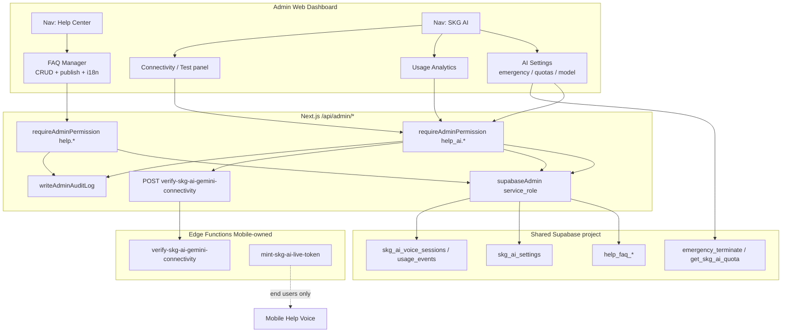

# SKG AI — Admin Web Architecture Audit

**Repository:** `/var/www/html/merigaadiwebsite`  
**Audit type:** READ ONLY (no code, schema, deploy, secret, commit, or SQL changes)  
**Date:** 2026-11-16  
**Companion:** Mobile V2 audit `sai-ki-gadi-app/docs/audits/SKG_AI_ARCHITECTURE_AUDIT.md`  
**Status legend:** Implemented · Partially implemented · Missing · Not Verified  

---

## A. Executive Summary

Admin Web currently has **no Help Center, FAQ, Gemini/AI Voice, AI settings, usage analytics, connectivity verification, or Test Assistant management surface**.

Evidence of absence (source search, 2026-11-16):

| Area | Admin Web finding |
|------|-------------------|
| Screens / tabs / nav | No FAQ / Help / AI / Gemini tab in `TabKey`, `navGroups`, or `TAB_PERMISSION_MAP` |
| API routes | No `/api/admin/*` routes for FAQ, `skg_ai_*`, Gemini, connectivity, or AI usage |
| Migrations in Admin repo | No `help_faq_*` / `skg_ai_*` migration among Admin `supabase/migrations` (13 files; Edge Functions only birthday + expire-memberships) |
| Permissions catalog | `lib/admin-permissions.ts` has **no** `help.*` / `help_ai.*` keys |
| Env template | `.env.example` has no `GEMINI_*` / `SKG_AI_*` vars |

Mobile owns the T29/T30 schema, RLS, RPCs, and Edge Functions (`20261110210000_skg_ai_help_center.sql`, `mint-skg-ai-live-token`, `verify-skg-ai-gemini-connectivity`). That migration **seeds Admin permission keys and documents required audit actions**, assuming an out-of-repo Admin console that **does not yet exist here**.

Prior Master audit already flagged T29 as greenfield for Admin: `docs/audits/SKG_Master_T01-T29_Code_Audit_20261109.md` L60, L103.

**Whether Mobile’s migration / Edge Functions are applied or deployed on Staging or Production is Not Verified from Admin source alone.** This audit did not connect to any database or Supabase project.

---

## B. Existing Admin AI Screens

### B1. Navigation and tabs (evidence of what exists)

**Tab union** — `app/dashboard/dashboard-tabs.tsx` L420–446:

`overview`, `pending`, `rejected-partial`, `not-started`, `winners`, `cities`, `sliders`, `users`, `birthday-date`, `requirements`, `exchanges`, `fraud-reports`, `member-reviews`, `priority-settings`, `profile-changes`, `car-verification`, `minimum-fares`, `fare-override-requests`, `active-fare-overrides`, `about-us`, `in-app-popups`, `wallet-management`, `membership-management`, `admin-users`, `admin-roles`, `audit-logs`.

**No** `help`, `faq`, `ai`, `gemini`, or similar keys.

**Content nav group** — same file L2057–2073:

- About Us, Sliders, Winners, In-App Pop-ups, Birthday  

Closest content cousins (not AI):

| Screen | Path evidence | Purpose |
|--------|---------------|---------|
| About Us | tab `about-us`; API `app/api/admin/about-us/route.ts` | Static About content (`about_us_content`) |
| In-App Pop-ups | tab `in-app-popups`; `app/api/admin/in-app-announcements/*` | Announcements, not FAQ |
| Birthday notifications | tab `birthday-date`; birthday test/settings APIs | FCM birthday digest (unrelated to Gemini Help) |
| Audit Logs | tab `audit-logs`; `app/api/admin/audit-logs/route.ts` | Generic admin audit viewer |

### B2. Requested surfaces vs Admin Web

| Requested Admin surface | Status in Admin Web | Evidence |
|-------------------------|---------------------|----------|
| Help Center management | **Missing** | No tab/component/API |
| FAQ management | **Missing** | No matches for `help_faq` / FAQ UI under `app/`, `lib/` |
| FAQ categories | **Missing** | — |
| FAQ translations (en/hi/gu) | **Missing** | — |
| Gemini / AI Voice settings | **Missing** | No `skg_ai_settings` usage |
| AI usage / quota dashboards | **Missing** | No session/usage queries |
| Connectivity verification UI | **Missing** | No proxy to `verify-skg-ai-gemini-connectivity` |
| Emergency disable UI | **Missing** | No call to `emergency_terminate_skg_ai_sessions` |
| AI testing / Test Assistant | **Missing** | Birthday/Lucky Draw “test” buttons are FCM-only |

**Do not assume UI works merely because a component exists:** for AI/Help, components do not exist.

---

## C. FAQ Management

### C1. Admin Web CRUD / publish / translations

| Capability | Admin Web | Trace |
|------------|-----------|-------|
| Create/edit/delete FAQ | **Missing** | No API under `app/api/admin/` |
| Draft/published status | **Missing** | — |
| Publish/unpublish | **Missing** | — |
| Category assignment | **Missing** | — |
| Gujarati / Hindi / English translations | **Missing** | — |
| Search / filtering (Admin) | **Missing** | — |
| Ordering / popular FAQ | **Missing** | — |

### C2. Schema contract (owned by Mobile migration — Admin must target this)

Source: `sai-ki-gadi-app/supabase/migrations/20261110210000_skg_ai_help_center.sql`

| Object | Lines (approx) | Notes |
|--------|----------------|-------|
| `help_faq_categories` | L54–61 | `key`, `sort_order`, `is_active` |
| `help_faqs` | L63–76 | `status` draft\|published, `sort_order`, `keywords`, `is_popular`, `published_at`, `created_by`/`updated_by` → `admin_panel_users` |
| `help_faq_translations` | L81–91 | locales `en`\|`hi`\|`gu`; FTS `search_vector` |
| Seeded categories | L173–181 | account_registration, otp_login, driver_requirements, booking_trips, payments, profile_documents, app_issues |
| Service role grants | L438–440 | INSERT/UPDATE/DELETE for Admin APIs |
| Authenticated select policies | L364–397 | **Published + active category only** |

### C3. Can mobile users see only published FAQs?

**Yes — by Mobile DB design (source), independent of Admin UI:**

- Policy `help_faqs_select_published` (Mobile migration ~L370–382): authenticated SELECT requires `status = 'published'` and active category.
- Translations policy joins published FAQ (~L384–397).
- Mobile client: `services/help/help-faq.service.ts` (Mobile audit).

**Not Verified:** whether this migration is applied on the Supabase project Admin’s `NEXT_PUBLIC_SUPABASE_URL` points to.

### C4. Intended Admin audit actions (schema contract, not implemented in Admin)

Mobile migration L1286–1290 documents required audit action names:

- `help.faq.create` | `help.faq.update` | `help.faq.publish` | `help.faq.unpublish`

Admin Web has generic `writeAdminAuditLog` / `recordSuccess` (`lib/admin-audit.ts`) but **no callers** for those help FAQ actions.

---

## D. Gemini Settings

### D1. Settings table (Mobile-owned; Admin UI Missing)

Table `public.skg_ai_settings` singleton `id = 1` (Mobile migration L187–213):

| Column | Admin can manage today? | Notes |
|--------|-------------------------|-------|
| `help_center_enabled` | **Missing** UI/API | Exposed to mobile via `get_skg_ai_quota()` |
| `voice_enabled` | **Missing** | CHECK: requires `voice_connectivity_verified_at` if true (L208–212) |
| `emergency_disabled` / `emergency_reason` / `emergency_disabled_at` / `emergency_disabled_by` | **Missing** | `emergency_disabled_by` → `admin_panel_users` |
| `gemini_model_id` | **Missing** | Default `gemini-3.8-live`; Edge allowlist separately |
| `weekly_allowance_seconds` | **Missing** | CHECK ≤ 600 |
| `max_session_seconds` | **Missing** | CHECK ≤ 120 |
| `lease_seconds` | **Missing** | 15–30 |
| `voice_connectivity_verified_at` | **Missing** | Must be stamped for voice on |
| `session_resumption_enabled` | **Missing** | Default false (privacy) |
| `supported_locales` | **Missing** | default `{en,hi,gu}` |
| `updated_by` | **Missing** | → `admin_panel_users` |

Grants: `service_role` SELECT/INSERT/UPDATE/DELETE on settings (Mobile L441). Authenticated has **no** direct SELECT (L428); mobile uses `get_skg_ai_quota()` (L741–787).

### D2. Admin APIs / components / permissions for settings

| Layer | Status | Evidence |
|-------|--------|----------|
| API routes | **Missing** | No `app/api/admin/**/skg*` / `help*` / `gemini*` |
| Components | **Missing** | — |
| Admin TS permissions | **Missing** | `lib/admin-permissions.ts` L8–58 — no `help_ai.*` |
| DB permission seeds (Mobile migration) | **Implemented in Mobile SQL** | L1296–1333: `help.view`, `help.manage`, `help_ai.view`, `help_ai.manage` |
| Admin UI wiring of those seeds | **Missing** | Catalog + routes not updated |

Intended audit actions (Mobile L1288–1289):  
`help_ai.settings.update` | `help_ai.emergency_disable` | `help_ai.emergency_enable` | `help_ai.voice_connectivity.verify`

Service-role RPC for kill-switch: `emergency_terminate_skg_ai_sessions(text)` (Mobile L1276–1277) — **no Admin proxy**.

---

## E. APIs and Backend

### E1. Admin Web — AI/FAQ endpoints

**None found.** Full Admin API inventory under `app/api/admin/` (59 route files) includes members, vehicles, fares, announcements, birthday/lucky-draw FCM, audit-logs, panel users/roles, etc. — **zero** Help/AI routes.

### E2. Pattern Admin *would* use (existing infra, not AI-specific)

| Pattern | File | Relevance |
|---------|------|-----------|
| Session + permission gate | `lib/admin-api.ts` (`requireAdminPermission`) | Required for any future Help/AI route |
| Service-role Supabase client | `lib/supabase-admin.ts` L109–115 | Needed to mutate FAQ/settings (RLS denies authenticated admin JWT for those tables) |
| Audit writer | `lib/admin-audit.ts` | Contract listed in Mobile migration L1286–1290 |
| Edge proxy example | `app/api/admin/birthday-notification-test/route.ts` L63–72 | How Admin invokes `functions/v1/...` with service-role Bearer |

### E3. Mobile-side endpoints Admin does **not** wrap today

| Endpoint | Method | Auth (Mobile) | Admin proxy |
|----------|--------|---------------|-------------|
| Edge `mint-skg-ai-live-token` | POST | User JWT | N/A (end-user) / **Missing** Admin test wrap |
| Edge `verify-skg-ai-gemini-connectivity` | POST | Service-role Bearer; Dev project lock | **Missing** |
| RPC `get_skg_ai_quota()` | — | authenticated / service_role | **Missing** Admin usage |
| RPC `reserve_skg_ai_voice_session(...)` | — | authenticated / service_role | Edge mint path |
| RPC `heartbeat_skg_ai_voice_session(...)` | — | authenticated / service_role | Mobile |
| RPC `settle_skg_ai_voice_session(...)` | — | authenticated / service_role | Mobile |
| RPC `emergency_terminate_skg_ai_sessions(text)` | — | **service_role only** | **Missing** Admin |
| RPC `reconcile_abandoned_skg_ai_sessions(integer)` | — | service_role | **Missing** |

### E4. Hypothetical future Admin endpoints (gap — not present)

For completeness against the requested report format: there are **no** HTTP methods, validations, or error handlers to document for FAQ/AI because routes do not exist. Any future implementation must:

1. Gate with `help.view` / `help.manage` / `help_ai.view` / `help_ai.manage` (after adding them to `ADMIN_PERMISSIONS`).
2. Use `supabaseAdmin` service role.
3. Write `admin_panel_audit_logs` with the action names above.
4. Never expose `GEMINI_API_KEY` to the browser.

---

## F. RBAC and Security

### F1. Admin permission definitions (this repo)

Canonical list: `lib/admin-permissions.ts` L8–58.  
Modules: dashboard, members, vehicles, listings, fraud, reviews, content, fares, settings (priority/birthday/lucky_draw), administration.

**Absent:** `help.view`, `help.manage`, `help_ai.view`, `help_ai.manage`.

Tab map: L67–94 — no Help/AI tabs.

### F2. Mobile-seeded permissions vs Admin catalog drift

| Permission | Seeded in Mobile SQL (L1296–1333) | In Admin `ADMIN_PERMISSIONS` | Used by Admin API/UI |
|------------|-----------------------------------|------------------------------|----------------------|
| `help.view` | Yes (super_admin, admin, manager, operator) | **No** | **No** |
| `help.manage` | Yes (super_admin, admin, manager) | **No** | **No** |
| `help_ai.view` | Yes (all four roles view) | **No** | **No** |
| `help_ai.manage` | Yes (super_admin, admin only) | **No** | **No** |

**Risk if migration applied on shared DB without Admin UI:**

- Permission rows may exist in `admin_panel_permissions` / role grants.
- Admin Roles UI may or may not display unknown keys depending on whether it reads DB vs TS catalog (**Not Verified** without UI path audit of panel-roles — Roles UI is DB-driven for assignments but module groups come from `PERMISSION_MODULES`).
- **No API exists**, so unauthorized Admins cannot modify AI config **through Admin Web**. Direct SQL/service-role still could — outside this UI.

### F3. Service role usage

`lib/supabase-admin.ts`:

- Documents Dev host `lhzgfhbnfbztwnowxxoy` and Production `uecdmytikvwiosnyndxe` (L9–12).
- Uses `SUPABASE_SERVICE_ROLE_KEY` (server-only); rejects accidental `NEXT_PUBLIC_` service key (L79–84).
- Future FAQ/settings writes **must** go through this client; authenticated PostgREST cannot update `skg_ai_settings`.

### F4. Audit logging

- Infrastructure: **Implemented** (`lib/admin-audit.ts`, `app/api/admin/audit-logs/route.ts`, permission `audit_logs.view`).
- Help/AI-specific audit actions: **Missing** callers.
- Unauthorized AI config changes via Admin UI: **N/A** (no UI) — residual risk is service-role misuse or raw SQL (**Not Verified** operationally).

### F5. Weak / missing controls (for future console)

| Issue | Status |
|-------|--------|
| No permission keys in Admin TS catalog | **Missing** |
| No route-level `requireAdminPermission("help_ai.manage")` | **Missing** |
| Connectivity verify Edge is Dev-project-locked; Admin must not stamp Prod blindly | Mobile Edge design; Admin proxy **Missing** |
| Emergency terminate is service_role-only — needs audited Admin proxy | **Missing** |

---

## G. Usage and Analytics

### G1. Data available in schema (Mobile) vs Admin display

| Metric | DB / RPC source | Displayed in Admin Web |
|--------|-----------------|------------------------|
| Total voice sessions | `skg_ai_voice_sessions` | **Missing** |
| Active / open sessions | unique open index + status/lease columns | **Missing** |
| Usage by user | sessions + `skg_ai_voice_usage_events` | **Missing** |
| Weekly usage / remaining quota | `get_skg_ai_quota()` → consumed/remaining seconds | **Missing** (mobile-facing RPC) |
| Failed sessions | usage `event_type = 'fail'` / session status | **Missing** |
| Gemini API errors | Edge `safeLog` only | **Missing** dashboard |
| Token usage (provider tokens) | **Missing** in schema (seconds-based) | N/A |
| Estimated cost ($) | **Missing** | N/A |
| Daily/monthly trends | derivable from sessions/events | **Missing** |

**Distinction:** ledger and quota math are **Implemented** on Mobile/DB source; Admin **displays none** of them.

---

## H. Test Assistant / Connectivity

| Capability | Admin Web | What exists elsewhere |
|------------|-----------|----------------------|
| Real test voice assistant UI | **Missing** | Mobile Help voice UI |
| Gemini connectivity test button | **Missing** | Edge `verify-skg-ai-gemini-connectivity` (Dev-only; does **not** stamp `voice_connectivity_verified_at` or enable voice — Mobile function header L10–12) |
| Model availability test | **Missing** | Part of verify Edge probe |
| Audio test | **Missing** | Mobile audio pipeline |
| Session quota test | **Missing** | Mobile + RPCs |
| Error diagnostics panel | **Missing** | Edge logs only |

**Existing Admin “test” buttons (not AI):**

1. Birthday “Send Test Notification” → `POST /api/admin/birthday-notification-test` → Edge `send-birthday-notification` with `{ force: true }` (currently returns `force_disabled` in source).  
2. Lucky Draw notification test → similar FCM proxy.

These do **not** exercise Gemini.

---

## I. Mobile / Admin Compatibility

| Contract | Mobile | Admin Web | Compatibility |
|----------|--------|-----------|---------------|
| `help_faq_categories` | Migration + RLS + seeds | No CRUD UI/API | **Schema-ready / Admin Missing** |
| `help_faqs` | draft/published + popular | No CRUD | **Admin Missing** |
| `help_faq_translations` | en/hi/gu + FTS | No CRUD | **Admin Missing** |
| `skg_ai_settings` | singleton + CHECKs | No settings UI | **Admin Missing** |
| `skg_ai_voice_sessions` | leases | No monitor UI | **Admin Missing** |
| `skg_ai_voice_usage_events` | immutable ledger | No analytics UI | **Admin Missing** |
| `get_skg_ai_quota()` | Mobile + Edge | Unused | **Admin Missing** |
| `reserve` / `heartbeat` / `settle` | Mobile + mint Edge | Unused | Expected (end-user) |
| `emergency_terminate_skg_ai_sessions` | service_role | No proxy | **Admin Missing** |
| Permission seeds `help*` / `help_ai*` | Inserted by Mobile SQL | Not in `ADMIN_PERMISSIONS` | **Drift** |
| Audit action contract | Documented in SQL comments | No writers | **Drift** |
| FAQ content inventory | No FAQ Q&A seed in migration | No Admin authoring | **Empty FAQ risk** if Help ships without content load |
| Admin migration copy of T29 SQL | — | **Absent** from Admin `supabase/migrations` | Dual-repo apply risk |

**Shared DB assumption:** Mobile comments and FKs to `admin_panel_users` imply one Supabase project shared with Admin. Admin `.env.example` defaults to Dev `lhzgfhbnfbztwnowxxoy`; Mobile AI connectivity verify locks to Dev ref `mnbwcwaxfywwkaxiwndo` — **project-ref mismatch risk** between Admin Dev URL and Mobile AI Dev project (**Partially documented** in birthday allowlists that include both refs).

---

## J. Environment Configuration

### J1. Admin source references (no secrets printed)

| Item | Evidence |
|------|----------|
| Dev Supabase URL (documented) | `lib/supabase-admin.ts` L9–10; `.env.example` L3–4 → `https://lhzgfhbnfbztwnowxxoy.supabase.co` |
| Production URL (documented, commented) | `lib/supabase-admin.ts` L11–12; `.env.example` L25–28 → `https://uecdmytikvwiosnyndxe.supabase.co` |
| Runtime URL | `NEXT_PUBLIC_SUPABASE_URL` |
| Anon key | `NEXT_PUBLIC_SUPABASE_ANON_KEY` |
| Service role | `SUPABASE_SERVICE_ROLE_KEY` (server-only) |
| Gemini / SKG AI env | **Not present** in Admin `.env.example` |

### J2. Edge Functions in Admin repo

| Function | Path | AI-related? |
|----------|------|-------------|
| `send-birthday-notification` | `supabase/functions/send-birthday-notification/` | No |
| `expire-memberships` | `supabase/functions/expire-memberships/` | No |
| Shared birthday schedule | `supabase/functions/_shared/` | No |

AI Edge Functions live in **Mobile** repo only (`mint-skg-ai-live-token`, `verify-skg-ai-gemini-connectivity`).

### J3. How Admin invokes Edge Functions today

Pattern: server route reads `NEXT_PUBLIC_SUPABASE_URL` + `SUPABASE_SERVICE_ROLE_KEY`, `fetch(`${url}/functions/v1/<name>`)` with Bearer service role  
Example: `app/api/admin/birthday-notification-test/route.ts` L45–72.

**No** such proxy exists for `verify-skg-ai-gemini-connectivity` or mint.

### J4. Deployment claims

| Claim | Status |
|-------|--------|
| T29 migration applied on Staging | **Not Verified** |
| T29 migration applied on Production | **Not Verified** (Mobile SQL says Staging-only until explicitly applied) |
| `mint-skg-ai-live-token` deployed | **Not Verified** |
| `verify-skg-ai-gemini-connectivity` deployed | **Not Verified** |
| Admin pointed at same project as Mobile Help | **Not Verified** (depends on live `.env.local`; not inspected for secret values) |

---

## K. Missing Capabilities (Future AI Management Console)

| # | Desired capability | Status | Notes |
|---|-------------------|--------|-------|
| 1 | AI enable/disable + emergency stop | **Partially implemented** (DB columns + `emergency_terminate_*` RPC) / Admin UI **Missing** | |
| 2 | Model/provider selection | **Partially implemented** (`gemini_model_id` + Edge allowlist) / Admin UI **Missing** | Provider fixed to Gemini Live |
| 3 | System prompt editing + version history | **Missing** | Mobile Live setup has no systemInstruction |
| 4 | SKG app knowledge / instructions | **Missing** (FAQ is separate non-LLM path) | |
| 5 | FAQ and Help Center management | **Missing** Admin; schema **Implemented** Mobile | |
| 6 | Feature-specific AI instructions | **Missing** | |
| 7 | AI tools / allowed actions | **Missing** | |
| 8 | Usage limits / per-user quotas | **Partially implemented** (global weekly/session ceilings) / Admin UI **Missing**; no per-user override table found | |
| 9 | Conversation/session monitoring + privacy | **Partially implemented** (sessions, no transcripts by design) / Admin UI **Missing** | |
| 10 | Usage, errors, cost analytics | **Partially implemented** (seconds ledger) / cost **Missing** / Admin UI **Missing** | |
| 11 | Test Assistant | **Missing** Admin; connectivity Edge **Partial** (Dev probe) | |
| 12 | AI request approvals + audit logs | Audit infra **Implemented**; AI-specific actions **Missing** | |
| 13 | Language configuration (gu/hi/en) | **Partially implemented** (`supported_locales` + FAQ locales) / Admin UI **Missing** | |
| 14 | Dev/Staging/Production controls | **Partial** env docs + project refs; no Admin AI env switcher | **Not Verified** live wiring |

---

## L. Recommended Admin Console Architecture

Design for a future console in **this** repo, aligned with Mobile contracts (implementation out of scope for this audit):

### Suggested module breakdown

1. **Help Center (FAQ)** — tabs for categories, FAQ list, translation editor (en/hi/gu), draft/publish, popular/sort; permissions `help.view` / `help.manage`.  
2. **SKG AI Settings** — toggles for help/voice/emergency, ceilings within DB CHECKs, model id within Edge allowlist, locale array; stamp connectivity only after successful verify + explicit admin confirm; `help_ai.manage`.  
3. **Usage** — aggregates from sessions/events; no transcript storage; `help_ai.view`.  
4. **Ops / Test** — proxy connectivity verify (respect Dev project lock); optional dry-run quota view; never mint with Admin service role into user sessions without a dedicated audited path.  
5. **RBAC sync** — add four keys to `ADMIN_PERMISSIONS` + `PERMISSION_MODULES` + `TAB_PERMISSION_MAP`; rely on Mobile seed or add Admin migration mirror.  
6. **Env safety** — Admin continues without browser Gemini secrets; verify/mint stay Edge-side.

### Priority order (recommended)

1. Permission catalog + FAQ CRUD/publish (unblocks Mobile Help content).  
2. Settings + emergency terminate proxy + audit actions.  
3. Connectivity verify proxy + safe stamp of `voice_connectivity_verified_at`.  
4. Usage analytics read-only.  
5. Prompt/knowledge/tools console — blocked until Mobile adds prompt/tool contracts.

---

## Evidence Index (Admin Web)

| Finding | Path | Lines |
|---------|------|-------|
| No AI permissions | `lib/admin-permissions.ts` | L8–58, L67–94, L96–203 |
| No AI tabs | `app/dashboard/dashboard-tabs.tsx` | L420–446, L2057–2073 |
| Admin API set (no AI) | `app/api/admin/**` | 59 routes; none FAQ/AI |
| Service role client / project refs | `lib/supabase-admin.ts` | L9–12, L21–26, L109–115 |
| Env template (no Gemini) | `.env.example` | L1–28 |
| Edge Functions present | `supabase/functions/` | birthday + expire only |
| Prior T29 Admin gap | `docs/audits/SKG_Master_T01-T29_Code_Audit_20261109.md` | L60, L103 |
| Mobile schema + Admin contract | `sai-ki-gadi-app/supabase/migrations/20261110210000_skg_ai_help_center.sql` | L54–213, L438–443, L741–787, L1276–1333 |
| Mobile connectivity Edge | `sai-ki-gadi-app/supabase/functions/verify-skg-ai-gemini-connectivity/index.ts` | L1–13 |
| Mobile architecture audit | `sai-ki-gadi-app/docs/audits/SKG_AI_ARCHITECTURE_AUDIT.md` | §A, §L |

---

## Confirmations

- **READ ONLY** for product code: no source, migration, SQL, deploy, secret, or git write for features.  
- Deliverable file created: `docs/audits/SKG_AI_ADMIN_ARCHITECTURE_AUDIT.md` (this document).  
- No Production or Staging database connections were made.  
- No credentials or FCM/Gemini secrets printed.
